# Haki Yangu — mobile user journeys and completion evidence

**Audit date:** 28 September 2026. **Basis:** routes and connected Convex calls in the current Expo launch app, plus the journey completion rule. This is a visual map of actual product paths, not a claim that the screens match the owner's images pixel for pixel.

## Reading the maps

- **C — Connected:** route and corresponding backend read/write are in code. This is implementation evidence, not a successful live scenario.
- **P — Partial:** route exists, but a significant step, scope, data supply, or decision experience is missing or unproven.
- **V — Verification needed:** needs a configured account, real records, device/browser QA, Tanzania legal/safeguarding review, or another actor to close the loop.
- **B — Blocked for release:** no verified source/provider data, no accepted operational workflow, or no demonstrated cross-role run.

**Full journeys complete under the agreed working rule: 0 of 11 user types.** Several screen-to-screen paths are connected in code. No role journey has yet passed the full cross-account, verified-data, device, accessibility, privacy, and legal/safeguarding release gate. Do not turn this into a percentage.

## 1. Guest / public visitor

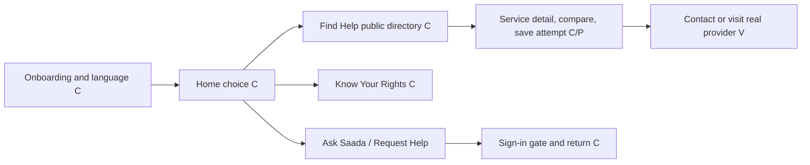

**Works in code:** guest browsing, language selection, verified-only directory query, search and no-result path, service detail, comparison, public learning, and protected-action sign-in gate. **Open:** real verified directory inventory/contacts and actual service visit validation; full phone visual and accessibility review. Saada conversation is signed-in only, so the guest gets a clear sign-in route rather than a sample answer.

## 2. Beneficiary / community member (`user`)

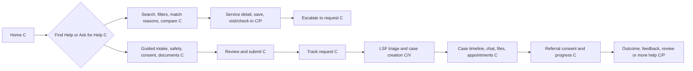

**Works in code:** draft/save/submit, request reference and status, case screens, scoped messages and documents, appointment actions, referral consent, outcome/feedback and case-review routes. **Open:** five real scenarios (employment, land, family, safety, no local service) with beneficiary + staff + provider accounts; verified service contacts; notification delivery, offline retry, safe-contact and consent language checks; full device QA. A case cannot be declared resolved merely because an outcome screen exists.

## 3. Verified paralegal (`paralegal`)

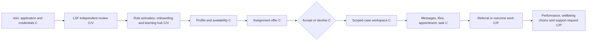

**Works in code:** application upload/status, LSF review screen, onboarding and readiness, a mobile learning hub linked to approved legal guides and work support, availability, offers, assigned cases, tasks, support requests and performance readout. A separate wellbeing choice screen leads to the existing protected LSF support request with the selected category carried forward; choosing on that screen sends no data. The learning hub handles zero approved guides explicitly; it does not certify training. **Open:** real application-to-activation run with two administrators where required; beneficiary/paralegal case rehearsal; revocation, expired-offer, denied-access and training/ethics validation. Earnings/benefits shown in the reference images are not established as a completed payment workflow.

## 4. Partner / provider staff (`provider_staff`)

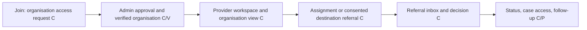

**Works in code:** access request, role review, organisation view and a new provider referral inbox/detail flow. The provider sees only referrals addressed to their active account after beneficiary consent, can record permitted status transitions and a reason for refusal or closure, and the backend notifies the beneficiary. **Open:** hard evidence of organisation-scoped membership and a real three-account consent-to-provider acceptance/decline/onward-referral run; provider-only visual QA and access revocation. This is not equivalent to a full organisation management portal.

## 5. LSF case worker (`staff`)

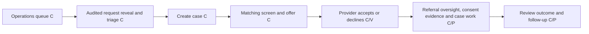

**Works in code:** queue, audited reveal, case creation, recommendation reasons/capacity, offer, case workspace and some directory governance. A staff referral oversight queue and detail show pending beneficiary consent, provider responses, returned/escalated referrals and uploaded consent evidence; evidence review records an audited decision distinct from beneficiary sharing consent. Mobile matching review now shows recorded reasons, safety flags and recommended services and can submit a review decision. Partner performance shows 30/90-day referral response and overdue counts from recorded events. **Open:** matching review mutation audit trail, full multi-account matching/assignment/referral run, staff scope checks, exception handling, service quality review, operational notifications and device QA. Offer is not acceptance.

## 6. LSF safeguarding officer (`safeguarding_officer`)

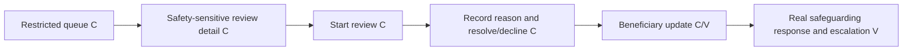

**Works in code:** restricted submitted + under-review queue and protected decision screen; backend scope limits safeguarding-only staff to safety-sensitive requests. **Open:** audited real incident rehearsal, local emergency referral/contact verification, response-time/escalation protocol, privacy and device QA. The app is not an emergency response service by virtue of this screen.

## 7. LSF supervisor (`supervisor`)

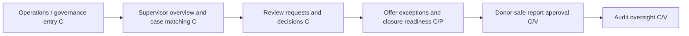

**Works in code:** the mobile supervision overview reads open review requests, pending/overdue assignment offers and open cases. It links to audited review decisions, safeguarding and audit screens. Matching now offers an audited reassignment with a required reason, and a dedicated closure review checks readiness before an audited status change. **Open:** end-to-end reassignment/closure exception rehearsal, service quality evidence beyond case-review requests, separation-of-duties and organisation scope testing, and phone visual acceptance. The reference “Supervisor Review” journey is still partial.

## 8. Content editor (`content_editor`)

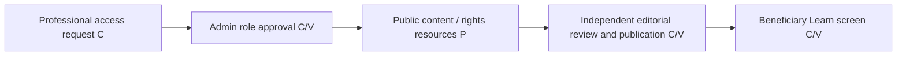

**Works in code:** request/approval path, mobile content-editor authoring and review workspace, bilingual guide submission, independent admin approval with source and review date, audit events, and approved-only beneficiary learning. These functions were deployed to the configured development Convex environment on 29 September 2026. The public Learn route rendered in the browser with zero approved guides; its browser storage crash was corrected. **Open:** verified content creation and independent publication rehearsal with separate accounts, version/supersession policy, native-device and language QA. The role is not the same as Saada source approver; Saada source/prompt approval is administrator-controlled.

## 9. Stakeholder viewer (`stakeholder`)

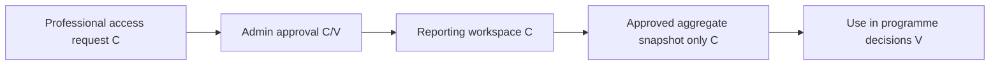

**Works in code:** reporting route restricts this role to approved snapshots. **Open:** real approved snapshot with suppressed small cells, distinct stakeholder account permission rehearsal, report interpretation and device QA. No case-level access should be granted.

## 10. Donor / reporting viewer (`donor`)

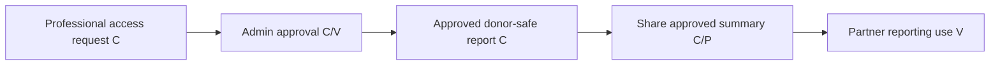

**Works in code:** approved-only reporting display; sharing a safe text summary. **Open:** real disclosure/privacy review, independent snapshot approval, recurring export/delivery, donor-account QA. A text-share action is not a complete donor reporting programme.

## 11. Administrator (`admin`)

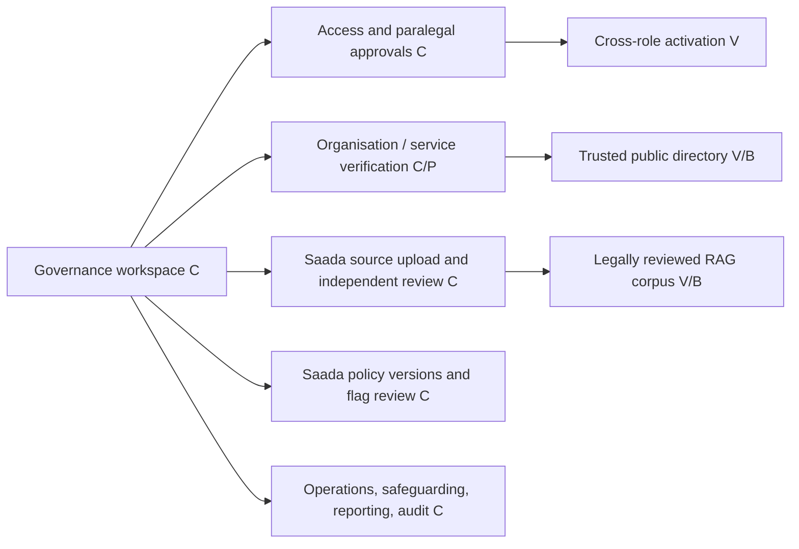

**Works in code:** access and paralegal review details, service directory controls, Saada library/upload, source and prompt version review, flagged-response disposition, reporting and audit routes. **Open:** two-admin separation rehearsal, verified Tanzanian source/provider data and update ownership, permissions/retention review, policy/legal review, full operational device run. Screens alone do not make Saada reliable.

## Cross-role handoffs that determine real completion

| Handoff | Code-connected? | Release evidence still needed |
| --- | --- | --- |
| Guest discovery → verified service contact | Yes | LSF-approved current service records, phone/hours and safe-publication check |
| Beneficiary request → LSF triage → case | Yes | Separate accounts, stored data/status/notification verification |
| LSF offer → paralegal acceptance → shared case | Yes | Two-account run, expiry/decline/reassignment and access revocation; reassignment screen now exists |
| Case → referral proposal → beneficiary consent → provider response | Yes | Three-account run, exact sharing list, withdrawal/onward route and privacy review |
| Saada question → approved source → cited answer → human help | Partial | Tanzania legal corpus, source freshness, evals, high-risk testing and human escalation rehearsal |
| Paralegal application → independent approval → live workspace | Yes | Identity/organisation verification, distinct approver and activation run |
| Saada source/prompt proposal → separate admin approval → retrieval/use | Yes | Two-admin rehearsal, legal review of material and post-approval retrieval proof |
| Content editor → independent guide approval → public Learn | Yes | Separate editor/admin accounts, reviewed Tanzanian source, publication and expiry proof |
| Operations data → donor-safe draft → separate approval → viewer | Yes | Small-cell/privacy review, distinct accounts and export QA |

## Immediate completion order

1. Visually exercise all existing routes on an actual phone in Kiswahili and English, including empty, error, restricted, and filled-data states; fix broken layouts/navigation.
2. Load and verify real public service records and approved legal sources with LSF ownership, provenance, contact checks and review dates.
3. Run end-to-end multi-account scenarios for beneficiary, staff, paralegal, provider, supervisor, safeguarding, admin, and donor roles, recording each status transition and notification.
4. Close remaining specific UI/workflow gaps: organisation-scoped provider management, Saada evaluation/human escalation, map/directions experience where verified coordinates exist, guide version/supersession and reporting delivery.
5. Perform Tanzania legal/safeguarding, privacy, accessibility, offline, security and release checks before claiming any journey fully complete.

**Current status:** the launch app has many connected screens and backend contracts; no user type has a fully evidenced, release-complete journey yet.

## Mobile management implementation update — 29 September 2026

The launch Expo app now has a governance home that links to access management, directory review, guide editorial, Saada source/evaluation management, paralegal training and reporting. These are connected routes in the app, not separate mockups. Directory staff can create and correct organisation and service drafts; material public-facing changes require reverification. Provider staff can update their own intake status and request a service correction. Role revocation is a two-admin request/decision, with audit history. Source review shows indexing failures and retry; withdrawn or overdue sources are excluded from retrieval. A replacement source stays pending while the approved version remains live; approval withdraws the previous version from retrieval. Saada evaluation cases record human observations without claiming automatic legal accuracy. Approved guides can be replaced or retired. The guide workspace now separates authoring and preview from the queue. Reporting has a preview, review reasons, rejection and approved-only device sharing with an initiation audit event. Paralegal training has bilingual source-backed module submission, independent approval, replacement and retirement, plus learner self-study acknowledgements; new onboarding completion checks current required modules.

**Evidence limits:** Root and mobile TypeScript checks, Convex security classification and the 62 contract checks passed locally. The home screen and sign-in were visually inspected on the simulator; the newly protected management screens were not exercised with signed-in LSF, paralegal or provider accounts on a device. Convex codegen later succeeded and reported uploading the current functions to the configured development backend. This confirms a development upload, not that cross-account journeys work. No real training module, approved Tanzania legal corpus or LSF-verified service inventory was supplied in this update. The report share event records opening the device share sheet, not confirmed recipient delivery. The training acknowledgement records self-study, not examination or certification. The 0/11 release-verified status above remains unchanged.

**Next acceptance work:** run separate-account LSF author/reviewer and paralegal learner scenarios against the updated development deployment; review every protected screen on phones in Swahili and English with filled, empty, error and restricted states; verify actual sources/contacts with LSF; rehearse beneficiary safety and case/referral scenarios; complete legal, safeguarding, privacy, offline and accessibility review. Do not infer 98–99% maturity from passing builds.

**Directory governance follow-up:** New organisation and service records now enter the shared backend as drafts; services are inactive. Verification requires a different LSF account from the creator or latest material editor and a recorded reason. Activation requires verification. Suspending or retiring an organisation pauses linked services, while service retirement preserves its audit record. The mobile review screens capture decision reasons; the existing web staff form now also creates drafts and asks reviewers for source evidence. These rules have focused local contract tests. They still need a two-account live backend rehearsal, including an edit followed by reverification and a beneficiary search confirming that paused records disappear.

**Latest lifecycle tightening:** Service reverification now covers all public-facing details, including coverage, eligibility, access and contact fields. Reverification checks the current linked organisation even when its link was not edited in that request. The provider workspace shows its linked professional roster through an organisation-scoped, name-only projection; LSF retains approval and revocation authority. The updated functions were uploaded to the configured development deployment by Convex codegen, but no signed-in provider or LSF device rehearsal has yet been recorded.

**Editorial review improvement:** Pending guides now open a focused mobile review screen showing complete Swahili and English text, source provenance, and the previous approved version when one is being replaced. Approval or rejection requires a recorded reason; the backend still enforces a different reviewer. Rejected originals and replacement submissions can be prefilled, edited, and resubmitted without publishing the rejected text. The new read query is scoped to administrators and the guide's submitting editor. Type checks, security classification (313 public Convex functions), iOS export, and development function upload passed. Visual and separate-account publication review remain outstanding.

**Saada index lifecycle follow-up:** Source approval now requires indexing status `ready`, a processed timestamp, at least one searchable chunk, complete provenance and a future review date. Index writes reject documents that have left the pending/processing state, and an in-progress source cannot be deleted while its indexing action is still writing. The source review screen shows the previous document and opens both PDFs for a replacement decision; it labels ready/failed/pending index states from the explicit status. A focused approval guard test joins the contract suite (63 passing). Root and mobile TypeScript, security checks, iOS export and the development function upload passed. This still does not prove legal correctness, PDF quality, retrieval accuracy or real-account screen behaviour.

**Base-role access lifecycle:** The mobile administrator workspace now has a dedicated bilingual request/review screen for professional roles stored on `users.role`. A different administrator must approve; self-review and a change that would remove the last active admin are rejected. Approval moves the base role to beneficiary, revokes duplicate assignments for that role and, for paralegals, withdraws their verified public listing. The web admin button now uses the same reviewed backend instead of the removed direct-reset mutation. Access audit lists both request and decision events. The 64 contract tests, root/mobile TypeScript, security classification (315 public functions), web build, iOS export and development function upload passed. A live two-admin test with active sessions and a paralegal public-search check is still required.

**Access directory scale follow-up:** The mobile access and base-role review screens, and the shared web access workspace, now page through the account directory instead of silently stopping after 300 people. Name/email search runs against dedicated backend indexes. Search currently returns at most 100 matching account records, so broad terms may need refinement; a one-character query explicitly asks for a second character. The web count is labelled as accounts *shown*, since it reflects the current page/search rather than the whole deployment. Root/mobile TypeScript, 64 contract checks, security classification (316 public functions), web build, iOS export, `git diff --check`, and development Convex codegen/upload passed. Signed-in, filled-data LSF device review, two-admin rehearsal and true whole-population count verification remain open. The 0/11 release-verified status is unchanged.

**Owner visual direction and directory screen pass — 29 September 2026:** The owner supplied a human-centred civic design brief with restrained soft-clay accents and identified the existing sign-in/sign-up look as the visual reference. The working rules are recorded in `mobile-human-civic-design-system.md`; this is design guidance, not a legal or provider source. The mobile directory workspace now has a direct-action verification queue for draft organisations and draft/expired services, separate from provider correction requests. Loading counts no longer imply zero, organisation/service empty states explain the next action, and verification badges are bilingual. Body and heading sizes on this screen were aligned more closely with the auth hierarchy. An initial queue filter used a nonexistent `pending` status; it was corrected to the schema's `draft`/`expired` lifecycle before verification. Root/mobile TypeScript and diff checks passed. This is a code-level UI pass; signed-in bilingual device screenshots and filled-record usability are still unverified, so the 0/11 release-verified status remains.

**Guide editorial screen pass:** The launch mobile editorial workspace now separates writing content, entering source provenance and previewing both languages before submission. Awaiting-review, published and historical versions have distinct tabs, with a paginated backend list so the newest 100 records are no longer the entire visible history. Editors see only their own records; administrators can page the full list. A submitter-admin sees an independent-review explanation instead of decision buttons on their own pending guide. The stage changes reset the mobile scroll to the top. Root/mobile TypeScript, 64 contract checks, 2 auth-routing checks and Convex security classification (317 public functions) passed locally. The first sandboxed Convex codegen attempt failed on DNS. A permitted development connection then completed codegen and reported uploading functions to the configured Convex backend. This is deployment evidence for the query, not a signed-in runtime or two-account publication test. Actual two-account publication, bilingual device review and public guide visibility remain unverified.

**Saada independent-review screen correction:** A pending source uploaded by the signed-in administrator now shows an explicit two-person-review explanation instead of offering approve/reject controls that the backend would reject. The approved-source withdrawal route remains available to authorised administrators. The source detail's main text hierarchy has been aligned with the auth-led mobile visual direction. This is an interface correction, not evidence of a live two-account approval run or indexed-answer accuracy.

**Saada evaluation lifecycle screen pass:** Active and retired test cases now use separate mobile views. Cases and their human-review history page through backend indexes instead of stopping at the newest 100 cases or 10 reviews. Administrators can retire an active case with a reason and confirmation; the backend preserves its reviews and audit event. The create form is disclosed on demand, and filled, empty, loading and restricted states are present. The configured development Convex command reported uploading the two new queries. Root/mobile TypeScript, security classification (319 public functions), 64 contract checks and diff checks passed locally. These are human-entered observations; no automatic legal accuracy claim, evaluated answer-to-source linkage or signed-in device acceptance is established. The 0/11 release-verified status remains.

**Access and base-role screen pass:** The mobile access workspace now explains when an administrator cannot remove their own access, when an assignment is a base role, and when an independent removal review is already pending. It shows organisation names rather than raw identifiers and confirms an approval that immediately removes access. The separate base-role page shows pending review on the account card and uses the auth-led title/body scale. Both pending-review backend queries now use status indexes, so completed requests cannot crowd out older pending cases. The configured development Convex command reported uploading these changes. Root/mobile TypeScript, 64 contract tests, 2 auth-routing tests, security classification, iOS export and diff checks passed. Signed-in two-administrator decisions, role revocation on a real account, Kiswahili/English phone screenshots and access-history usability remain unverified; this does not change the 0/11 release-verified count.

**Governance entry screen pass:** Staff can now reach Platform governance directly from Profile, matching the route's existing role guard. The overview shows loading rather than an implied zero, previews only three access requests before opening the full queue, and keeps Saada flagged-message text within its protected detail screen. The directory review link is direct, and the typography follows the auth-led mobile direction. Mobile TypeScript, 64 contract checks, iOS export and diff checks passed. Real role-based navigation, populated bilingual phone screenshots, accessibility and privacy review remain open.

**Directory independent-review screen pass:** The organisation and service detail screens now disable verification when the signed-in LSF user created or materially edited the record, matching the backend's different-reviewer rule. They explain that state in both languages, limit lifecycle reason fields to the backend maximum, show save feedback, and use larger auth-led copy. Mobile TypeScript, 64 contract checks, iOS export and diff checks passed. A real creator/reviewer two-account flow, approved public-directory visibility, phone visual review and verified Tanzanian records remain unproven.

**Directory readiness lifecycle pass:** LSF staff can now edit referral safeguarding readiness, data-sharing agreement version and response target from the mobile organisation detail; activation or suspension requires a reason and confirmation. Backend activation requires a verified organisation, safeguarding readiness and a recorded agreement version. Mobile service intake changes require a reason and explicit confirmation, and the backend now enforces the decision reason for that state transition. The configured development Convex command reported uploading these rules. Root/mobile TypeScript, 65 contract checks, security classification, iOS export and diff checks passed. Real signed agreement evidence, provider contact verification, creator/reviewer accounts, bilingual phone visual QA and live referral routing are still open.

**Guide editorial queue and review pass:** Pending, approved and historical guide tabs now use backend-filtered pagination rather than loading mixed versions and filtering on the phone. Authoring validates both languages and source fields before moving to preview. The reviewer can open the cited HTTPS source; an elapsed source-review date disables approval with a clear explanation. The editor labels expired approved guides as no longer public and avoids linking to a hidden public page. The configured development Convex command reported uploading the new query; mobile TypeScript, 65 contract checks, iOS export and diff checks passed. Independent editor/reviewer accounts, source verification, translation/legal review and bilingual phone screenshots remain open.

**Saada source library pass:** The launch mobile library now pages pending, approved and historical sources through a status index; the source detail queries its document and predecessor directly by ID rather than searching only the newest 100 documents. The configured development Convex command reported uploading the index and queries. Root/mobile TypeScript, 65 contract checks, security classification (321 public functions), iOS export and diff checks passed. Real upload/index/retry/independent approval/withdrawal account flows, approved-answer retrieval, Tanzanian source provenance and bilingual phone inspection remain unverified.

**Saada flagged-response handoff — 30 September 2026:** The mobile governance overview previews three open flags and links to a paginated staff queue; its list response contains only event identity, type, source, status and time. A protected by-ID detail no longer loses a flag outside the newest 50. Human disposition requires a reason, cannot be repeated, and writes an audit event. Escalated and case-follow-up dispositions enter an internal pending queue. An authorised staff member can claim a flag, and only that claimant can complete it with a written outcome; an administrator can return an in-progress item to the queue with a reason. These actions update the shared Convex record and audit trail, and the development function upload succeeded. Mobile and Convex TypeScript, security classification (332 public functions), 65 contract checks and diff checks passed. This is internal work tracking only: it does not dispatch an emergency response, notify a beneficiary, create a legal case or prove that external follow-up occurred. The two-staff real-account handoff, safeguarding procedure, filled bilingual phone screens and notification expectations still need rehearsal. The 0/11 release-verified status remains unchanged.

**Saada evaluation versioning — 30 September 2026:** An LSF administrator can now correct an active test question as a new version, with a recorded reason. The backend atomically retires the prior case, links both versions, and preserves the prior human reviews under the original question. The mobile workspace preloads the active case for revision and shows the version links in active and retired views. Staff may still add review observations but cannot replace or retire cases. Mobile and Convex TypeScript, security classification (333 public functions), all 65 contract checks and diff checks passed. The configured Convex codegen/upload attempt failed with `fetch failed`, so this new mutation has **not** been confirmed on the development backend. A signed-in administrator flow, answer/source linkage, and bilingual phone visual acceptance remain unverified; release-verified status remains 0/11.

**Access-history privacy and usability — 30 September 2026:** The administrator role-audit query now returns a narrow projection rather than raw audit rows and metadata. The mobile access screen identifies the actor, affected account, role where recorded, action and time; the web access panel uses the same projected names. It does not disclose free-text request/review reasons in the history listing. Root, mobile and Convex TypeScript, security classification (333 public functions), all 65 contract checks and diff checks passed. The running Expo Web route showed its Kiswahili admin-required restricted state without exposing audit details. The admin-filled view, English layout and phone device state still require account-based visual review. The changed query has not been confirmed on the development Convex backend since codegen/upload failed with `fetch failed` on the preceding attempt. Release-verified status remains 0/11.

**Directory correction queue continuity — 30 September 2026:** The LSF mobile correction queue now pages through pending provider requests instead of stopping at 100. A selected request opens through a role-protected by-ID backend query, so it remains reachable after newer requests arrive. The detail screen distinguishes pending from applied/rejected records and displays the recorded review reason without offering a second decision. Mobile/Convex TypeScript, security classification (335 public functions), 65 contract checks and diff checks passed. Development backend upload again failed with `fetch failed`; these new queries are therefore not confirmed in the running backend. The queue's populated bilingual phone state and a provider-to-LSF two-account correction run remain unverified; release-verified status remains 0/11.

**Provider correction evidence link — 30 September 2026:** A correction can now be marked applied only after an LSF editor opens the service form from that specific pending request, changes at least one service field, and records how the edit addresses the request. The backend writes the service edit and its link to the correction atomically; an unrelated later service edit no longer satisfies the applied guard. The review screen shows the linked edit and its note before the reviewer decides. Optional contact and location text can be cleared in the form as an explicit change. A focused contract test covers missing, stale and valid linked edits; 66 contract checks, mobile/Convex TypeScript, security classification (335 public functions) and diff checks passed. Convex codegen completed and uploaded these functions to the configured development backend after a permitted network retry, resolving the prior upload limitation for the latest code. This confirms development deployment, not that a provider and LSF account completed the request-to-decision path on device or that LSF validated the correction against a real provider. Release-verified status remains 0/11.

**Access-review queue scaling — 30 September 2026:** Mobile assignment-revocation and base-role removal queues now page pending requests. Each user projection independently reports a pending base-role request and each active assignment reports a pending revocation, so the screen does not infer “no pending review” from only the loaded queue page. Backend duplicate-request checks now use the matching status indexes. The two-person approval and last-administrator guards remain in place. Mobile/Convex TypeScript, security classification (337 public functions), 66 contract checks, two auth-routing checks and diff checks passed. Convex codegen uploaded the changes to the configured development backend. Real two-admin role removal, populated bilingual phone screenshots and access revocation timing remain unverified; release-verified status remains 0/11.

**Public guide correction lineage — 30 September 2026:** The mobile editor now discards all prefilled content when cancelling a version revision, avoiding accidental creation of a separate guide from copied text. It identifies the publication being replaced and validates the review date without accepting impossible calendar dates. Rejected drafts can be corrected by their original editor with an explicit `resubmitsGuideId`; the backend preserves the rejection trail, requires the same replacement target, and blocks a second pending resubmission. The review screen shows the rejected draft, its reason and both language versions beside the corrected submission. A corrected rejection retains the intended publication version number and still needs independent admin approval. Mobile/Convex TypeScript, 67 contract checks, iOS export and diff checks passed; Convex codegen uploaded the schema/functions to the configured development backend. An editor/admin two-account publication run, Tanzania legal-source review and bilingual phone visual acceptance remain open. Release-verified status remains 0/11.

**Saada evaluation response linkage — 30 September 2026:** LSF reviewers can open a test question in the live Saada mobile chat, send it themselves, return to the evaluation workspace, and select one of their own completed responses for that exact question. The completed assistant message records a bounded snapshot of retrieved approved source metadata. The review mutation verifies response ownership and question match, prevents duplicate reviews of the same response by the same reviewer, and saves the observed answer and retrieval snapshot for later inspection. The UI labels these as *retrieved sources*, not proof that the answer cited them correctly. This is an integrated development-backend flow, not a legal-accuracy claim. Mobile/Convex TypeScript, 67 contract checks, security classification (338 public functions), and diff checks passed; Convex codegen uploaded the change to the configured development backend. A real reviewer account test, source/citation quality assessment, bilingual phone inspection, and Tanzania legal review remain open. Release-verified status remains 0/11.

**Provider intake-capacity screen — 30 September 2026:** The launch mobile organisation workspace now lets authorised provider staff review and save a linked service's intake state together with an optional nonnegative integer count of currently available places. It reads the saved count from the same organisation-scoped backend query and writes through the existing audited provider intake mutation; the backend enforces organisation scope and range. The screen distinguishes an unknown count from zero, validates before save, and shows success or error. Mobile and Convex TypeScript and diff checks passed; Convex codegen uploaded the changed projection to the configured development backend. A real provider account save, staff matching observation, and bilingual phone review remain unverified. Release-verified status remains 0/11.

**Organisation member access handoff — 30 September 2026:** The LSF administrator's organisation detail now opens an active member in the existing access-management route with that member's email prefilled. The administrator can inspect the member's roles there and request revocation through the established independent-review path; this does not remove access on tap. Member lookup remains administrator-only. Mobile TypeScript, Convex security classification and diff checks passed. A populated organisation, two-administrator revocation rehearsal and bilingual phone review remain open.

**Bilingual simulator observation — 30 September 2026:** On the booted iPhone 17 Pro Max (iOS 26.5), the existing smoke-test beneficiary account displayed the English home and Kiswahili home, profile, Find Help entry, no-published-service result, and Saada initial consent/chat state without visible text clipping or hidden primary actions. Find Help retained the selected employment category across search and back navigation. The live result reported zero published verified services and offered a route to ask LSF for help; this is evidence of the empty state, not of a populated directory or verified contacts. The test account's language was restored to English after review. The simulator is a single large phone; small-phone layouts, filled records, errors/offline states, staff/provider screens, and legal-answer quality are still unverified. This observation does not change the 0/11 release-verified journeys.

**Capacity/matching consistency — 30 September 2026:** A service with zero available places can no longer be saved as open/limited/emergency-only in provider, creation or staff-edit writes; the provider screen explains that zero requires Closed. Assignment matching excludes any legacy zero-capacity record even if its older intake state says open. Mobile/Convex TypeScript and diff checks passed, and Convex codegen uploaded the rules to the configured development backend. This is code/deployment evidence, not a provider-to-beneficiary account rehearsal.

**Request-wizard mobile layout correction — 30 September 2026:** The initial issue-selection screen had its Next and Save-for-later actions below the visible area on the large iPhone simulator. The shared `Screen` now supports an optional safe-area footer, and the launch intake wizard uses it so Next/Submit and Save-for-later stay visible while the eight-step form scrolls. In the rebuilt Expo Go app on iPhone 17 Pro Max, English step 1 and step 2 and Kiswahili step 1 showed the footer without clipping; selecting employment enabled Next, and step 2 kept its input and actions reachable. A synthetic layout-test sentence was typed into an unsaved draft but no request was submitted; the app was reloaded afterward, leaving any previously saved secure draft untouched. Mobile TypeScript and iOS bundling passed. Smaller devices, keyboard-on-screen behavior, all later steps, screen-reader navigation, and real submission/recovery are not yet accepted.

**LSF directory pagination and search — 30 September 2026:** The mobile directory workspace now pages organisations, services and draft/expired verification queues independently, and searches service name, region and district through backend search indexes. Counts say records *shown* rather than imply a complete inventory; broad search is capped at 100 displayed matches. The governance preview also pages draft and expired service records. The 67 contract checks, mobile/Convex TypeScript, security classification, iOS export and diff checks passed; Convex codegen uploaded the schema and functions to the configured development backend. This is integrated code and development deployment evidence. Populated-directory visual review and real LSF account checks remain open, so the 0/11 release-verified status does not change.

**LSF organisation lookup — 30 September 2026:** The same mobile directory now searches organisation names across the backend rather than only the current page. The list distinguishes a one-character query, an empty result, and a capped result set of 100. The new query is staff-restricted; schema and function changes were uploaded to the configured development backend. Mobile/Convex TypeScript, 67 contract checks, 342-function security classification and diff checks passed. Populated LSF phone review and verified organisation records remain open.

**Saada overdue-source visibility — 30 September 2026:** The source library and detail page now identify an approved source with a missing or passed review date as overdue and excluded from answers, matching the existing backend retrieval gate. Preparing a replacement clears any previously selected PDF and scrolls to the upload form so the replacement context is visible. Mobile TypeScript, 67 contract checks, iOS export and diff checks passed. A reviewer account still needs to inspect an actual overdue source and complete the replacement approval on a phone; no legal-source accuracy or release acceptance is claimed.

**Saada evaluation run integrity — 30 September 2026:** The review picker now fetches completed responses for an active evaluation case rather than accepting a free-text question, and both picker and save reject responses generated before that case was created. Exact-question matching and reviewer ownership checks remain. This prevents an older chat with identical wording being reused as evidence for a newly created test. Mobile/Convex TypeScript, 67 contract checks, 342-function security classification, iOS export and diff checks passed; Convex codegen uploaded the function to the configured development backend. A real reviewer run and legal-quality assessment remain open.

**Paralegal review queue pagination — 30 September 2026:** The LSF mobile governance preview and full paralegal application queue now use separate indexed pages for pending and under-review applications. Staff can load more in either status without the screen reading the entire application table, and the governance metric says records shown rather than a whole-system total. The reviewer detail and decision flow remain linked from each row. Mobile/Convex TypeScript, 67 contract checks, 343-function security classification, iOS export and diff checks passed; Convex codegen uploaded the query to the configured development backend. Filled-data bilingual phone review and an LSF approval run remain open.

**Access decision organisation picker — 30 September 2026:** The mobile approval screen now pages verified organisations and searches names across the indexed staff directory. It no longer downloads every organisation and its services just to choose an approval destination. The selected organisation clears when the search changes; the backend still checks current verification, LSF type and active referral agreement at the point of approval. Mobile TypeScript, 67 contract checks, iOS export and diff checks passed. A populated two-administrator phone rehearsal remains open.

**Service review expiry and renewal — 30 September 2026:** Public Find Help and matching now require a future service review date; legacy verified records with no date and overdue records are excluded. The mobile service detail explains this state and lets an independent LSF reviewer renew verification with a new check date, future review date, source, authority and reason. The backend enforces independent review and new dates on renewal, while preserving the record and audit history. Mobile/Convex TypeScript, 68 contract checks including review-date boundaries, 343-function security classification, iOS export and diff checks passed; Convex codegen uploaded the rule to the configured development backend. An LSF two-account renewal and populated public-result check remain open; release verification remains 0/11.

**Guide source-review queue — 30 September 2026:** The mobile editorial workspace now has a Review due tab for approved guides whose source review is overdue or due within 30 days. Admins see the indexed cross-editor queue; content editors see their own indexed queue. Opening a replacement clears the prior review date so the author must deliberately check the source and set a new one before submission. Mobile/Convex TypeScript, 68 contract checks, 343-function security classification, iOS export and diff checks passed; Convex codegen uploaded the index and query to the configured development backend. The Mac was locked when a simulator check was attempted, so bilingual device acceptance and a real editor/admin publication run remain open.

**Saada source-review queue and admin navigation — 30 September 2026:** Approved sources with missing, overdue or next-30-day review dates now appear in an indexed mobile Review due queue. The replacement form requires a deliberately entered new review date; its notice no longer implies an expired old source still supports answers. The LSF governance home now shows paged draft-organisation, draft/expired-service and due-source counts explicitly as records shown, with a direct link to Saada's due queue. Mobile and Convex TypeScript, 68 contract checks, 343-function security classification, iOS export and diff checks passed; Convex codegen uploaded the index/query to the development backend. A filled-data LSF phone review and source replacement approval remain unverified.

**Organisation suspension invariant — 30 September 2026:** Suspending or retiring an organisation now makes the backend suspend its active referral agreement even when a client omits that field; an unverified organisation cannot activate an agreement in the same write. The existing linked-service invalidation continues to remove its verified public services when verification is lost. Mobile/Convex TypeScript, 69 contract checks, 343-function security classification and diff checks passed; Convex codegen uploaded the mutation to development. Existing in-flight referrals, provider access effects and a separate-account phone rehearsal still need review; this is not release verification.

**Suspended-provider referral follow-up — 30 September 2026:** The provider referral inbox now omits referrals whose destination organisation is suspended or retired, and the backend rejects further provider status changes on those referrals. LSF's mobile referral queue flags an unavailable destination as needing attention and the detail screen explains that staff must arrange an alternative; beneficiary approval already rechecks destination availability. Mobile/Convex TypeScript, 69 contract checks, 343-function security classification, iOS export and diff checks passed; Convex codegen uploaded the functions to development. Existing case-participant access, reassignment of in-flight referrals, and a real provider/LSF/beneficiary scenario still need a broader review. These checks do not establish release readiness.

**Case-participant role revocation — 30 September 2026:** A case-participant row no longer grants professional case access after the matching paralegal, provider or staff role is lost. This protects the role-revocation path without deleting historical participation. Beneficiaries retain access to their own cases and LSF admin/supervisor access follows their current roles. Mobile/Convex TypeScript, 70 contract checks, 343-function security classification and diff checks passed; Convex codegen uploaded the access rule to development. Organisation-scoped suspension still requires a separate access audit, because participation records do not record an organisation and a person may hold multiple affiliations. Separate-account revocation and phone review remain open.

**Role loss across case lists — 30 September 2026:** The My Cases, conversations, documents, appointments, staff case queue and task list now apply the same current-role check as case detail access. Completing an old task also requires current case-worker access. This removes list-level exposure after a professional role is revoked or a participant is removed from a case. Mobile/Convex TypeScript, 70 contract checks, 343-function security classification and diff checks passed; Convex codegen uploaded the queries and mutation to development. Precise organisation-level access cannot yet be enforced for assignments made without an organisation ID; the current case assignment and participant schema only identifies the person. This needs a scoped assignment model and data migration before claiming suspension closes every case-access route.

**Organisation-scoped new assignments — 30 September 2026:** New case offers now record the selected verified organisation and professional role on the assignment. Staff see the worker's verified affiliations on the mobile matching screen and must choose one when there are several. The backend validates that affiliation at offer and acceptance time, stores it on the case participant, and checks that the organisation remains verified and the exact role assignment remains active on case detail, lists, documents, appointments and tasks. Suspending an organisation therefore blocks *new scoped* case access without removing a worker's separate verified affiliation. A legacy individual paralegal can still receive an unscoped offer only when they have no active organisation membership. Mobile/Convex TypeScript, 70 contract checks, 343-function security classification, iOS export and diff checks passed; Convex codegen uploaded the schema/functions to development. Existing unscoped assignments and participants are not automatically migrated; they require an LSF review path before the organisation-suspension journey can be marked complete. Multi-account acceptance and bilingual phone checks remain unverified.

**Legacy case affiliation review — 30 September 2026:** LSF admins now have a paginated mobile queue for active professional case participants without a recorded affiliation. An independent admin can assign the worker's current verified organisation and role, or record an independent classification only for a base-role paralegal without active organisation membership; each decision needs a reason and creates an audit record. The linked accepted assignment is updated without deleting history. Legacy unreviewed professional participation is now denied in case detail and list queries until reviewed, and the queue is linked from governance and access management. This may pause older workers' case access until LSF completes the review. Mobile/Convex TypeScript, 71 contract checks, 345-function security classification, iOS export and diff checks passed; codegen uploaded the schema/functions to the configured development backend. This does not prove the old records have been reviewed, the review UI works with real admin accounts, or that phone layouts have been accepted.

**Case alert and older-offer consistency — 30 September 2026:** Older offers without a recorded worker role can no longer be accepted into a case that the worker could not open; workers are directed to ask LSF for a new scoped offer. New independent offers are rechecked against the worker's current base role and organisation membership at acceptance. Case-message, voice-message and beneficiary appointment-request alerts now go only to active participants whose current role and organisation still grant case access. Convex TypeScript, 71 contract checks, 345-function security classification and diff checks passed; the configured development Convex command reported functions ready. A simulator screenshot confirmed the current guest home renders on iPhone 17 Pro Max, but it did not test the signed-in admin queue, two-account assignment or notification delivery. Those remain open.

**Saada evaluation run discovery — 30 September 2026:** The mobile human-review picker now pages through the signed-in reviewer's own completed Saada answers instead of limiting selection to the latest 80 assistant messages. It can continue searching older pages even when the first page has no answer matching the test question. The backend still rejects a response from another account, a response before the test case, a non-matching question, or a repeated review by the same person. Mobile/Convex TypeScript, 71 contract checks and 345-function security classification passed, and the configured development Convex command reported functions ready. This improves access to saved evaluation evidence; it does not establish answer correctness, citation fidelity or a signed-in reviewer phone run.

**Bilingual beneficiary device pass — 30 September 2026:** On an iPhone 17 Pro Max simulator, the signed-in smoke-test beneficiary switched Profile to Kiswahili; Home, Profile and Find Help entry and result layouts were visibly inspected. The configured directory returned zero published verified services. Its empty state explained the absence and the LSF-assignment action opened the request intake at step 1 of 8. Profile's mixed-language saved-guide copy was corrected, its empty guide state now opens the actual Jua haki zako screen, and the development-only account-screen preview link was removed from the normal Profile menu. The updated Profile navigation was exercised in the simulator, and mobile TypeScript and diff checks passed. This is a narrow single-device, single-account pass; it does not verify populated directory cards, LSF management screens, English layouts after this edit, accessibility beyond visible labels, or release data. LSF must publish verified service records before Find Help can be accepted with real contacts.

**Bilingual LSF directory labels — 30 September 2026:** Code inspection found raw English backend enum values in the Kiswahili organisation and service create/edit/review screens. A shared label map now covers organisation and service-point types, verification and referral statuses, intake, visibility and membership roles; the service capability booleans also use Ndiyo/Hapana in Kiswahili. Mobile TypeScript, iOS export and diff checks passed. These are label corrections in the launch app, but no signed-in LSF account has visually reviewed populated records on a phone, so admin bilingual acceptance remains open.

**Public guide review-date refresh — 30 September 2026:** An approved legal guide is already excluded from fresh public backend reads when its source review date passes. The open mobile Learn list and guide detail now refresh that server-side eligibility check about once a minute and on app foreground, and locally hide an expired item while refreshing. This closes the stale-open-screen path where a guide could remain visible after expiry without any database write. Convex/mobile TypeScript, 71 contract checks, 345-function security classification and diff checks passed; the configured development Convex command reported functions ready. No approved guide exists in the current simulator account data to exercise an actual expiry, and this change does not verify legal content or editor/admin publication decisions.

**Built-in checklist distinction — 30 September 2026:** The six static preparation items have no legal source, version or independent LSF approval record. The launch app now calls them preparation checklists in Learn, Profile, Offline and their detail screens, and explains that they are general prompts rather than reviewed legal guidance. The separate approved-guide library still requires its backend publication gate. Offline copy now says current guide approval and review dates require a connection. Mobile TypeScript, iOS export and diff checks passed. This is a content-status presentation correction; the checklists' individual wording still needs Tanzania legal/safeguarding review, and no device visual acceptance was recorded for these four screens. The 0/11 release-verified status is unchanged.

**Provider intake after directory suspension — 30 September 2026:** A provider's intake mutation now checks that the linked organisation and service are still verified and that the service is active before saving availability or capacity. The mobile organisation screen hides the intake editor and explains LSF review is required when either record is inactive; providers can still request a correction. This aligns provider controls with LSF's directory lifecycle after suspension, retirement or expiry. Mobile and root TypeScript, 71 contract checks, 345-function security classification, iOS export and diff checks passed; the configured development Convex command reported functions ready. A provider/LSF two-account suspension and reinstatement run on a phone is still unverified; no release-readiness claim follows from these checks.

**Multiple provider affiliations — 30 September 2026:** The prior My Organisation query silently selected the first active professional organisation. A new scoped list allows an affiliated provider/paralegal to switch organisations on the launch mobile screen. Linked services and the staff list use the selected organisation, and the backend rejects an unapproved organisation ID; intake controls require a provider-staff affiliation for the selected organisation. Mobile/root TypeScript, 71 contract checks, 346-function security classification, iOS export and development Convex upload passed. A real multiple-affiliation account and bilingual device review remain outstanding; this is not release verification. The current consolidated audit is `mobile-product-status-2026-09-30.md`.
