# Haki Yangu — mobile user journeys and completion evidence

**Audit date:** 28 September 2026. **Basis:** routes and connected Convex calls in the current Expo launch app, plus the journey completion rule. This is a visual map of actual product paths, not a claim that the screens match the owner's images pixel for pixel.

## Reading the maps

- **C — Connected:** route and corresponding backend read/write are in code. This is implementation evidence, not a successful live scenario.
- **P — Partial:** route exists, but a significant step, scope, data supply, or decision experience is missing or unproven.
- **V — Verification needed:** needs a configured account, real records, device/browser QA, Tanzania legal/safeguarding review, or another actor to close the loop.
- **B — Blocked for release:** no verified source/provider data, no accepted operational workflow, or no demonstrated cross-role run.

**Full journeys complete under the agreed working rule: 0 of 11 user types.** Several screen-to-screen paths are connected in code. No role journey has yet passed the full cross-account, verified-data, device, accessibility, privacy, and legal/safeguarding release gate. Do not turn this into a percentage.

## 1. Guest / public visitor

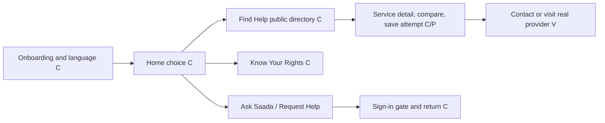

**Works in code:** guest browsing, language selection, verified-only directory query, search and no-result path, service detail, comparison, public learning, and protected-action sign-in gate. **Open:** real verified directory inventory/contacts and actual service visit validation; full phone visual and accessibility review. Saada conversation is signed-in only, so the guest gets a clear sign-in route rather than a sample answer.

## 2. Beneficiary / community member (`user`)

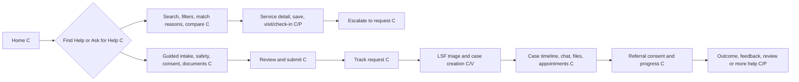

**Works in code:** draft/save/submit, request reference and status, case screens, scoped messages and documents, appointment actions, referral consent, outcome/feedback and case-review routes. **Open:** five real scenarios (employment, land, family, safety, no local service) with beneficiary + staff + provider accounts; verified service contacts; notification delivery, offline retry, safe-contact and consent language checks; full device QA. A case cannot be declared resolved merely because an outcome screen exists.

## 3. Verified paralegal (`paralegal`)

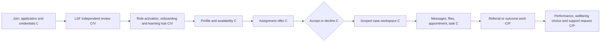

**Works in code:** application upload/status, LSF review screen, onboarding and readiness, a mobile learning hub linked to approved legal guides and work support, availability, offers, assigned cases, tasks, support requests and performance readout. A separate wellbeing choice screen leads to the existing protected LSF support request with the selected category carried forward; choosing on that screen sends no data. The learning hub handles zero approved guides explicitly; it does not certify training. **Open:** real application-to-activation run with two administrators where required; beneficiary/paralegal case rehearsal; revocation, expired-offer, denied-access and training/ethics validation. Earnings/benefits shown in the reference images are not established as a completed payment workflow.

## 4. Partner / provider staff (`provider_staff`)

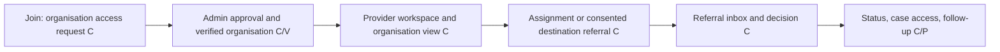

**Works in code:** access request, role review, organisation view and a new provider referral inbox/detail flow. The provider sees only referrals addressed to their active account after beneficiary consent, can record permitted status transitions and a reason for refusal or closure, and the backend notifies the beneficiary. **Open:** hard evidence of organisation-scoped membership and a real three-account consent-to-provider acceptance/decline/onward-referral run; provider-only visual QA and access revocation. This is not equivalent to a full organisation management portal.

## 5. LSF case worker (`staff`)

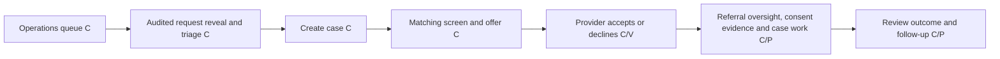

**Works in code:** queue, audited reveal, case creation, recommendation reasons/capacity, offer, case workspace and some directory governance. A staff referral oversight queue and detail show pending beneficiary consent, provider responses, returned/escalated referrals and uploaded consent evidence; evidence review records an audited decision distinct from beneficiary sharing consent. Mobile matching review now shows recorded reasons, safety flags and recommended services and can submit a review decision. Partner performance shows 30/90-day referral response and overdue counts from recorded events. **Open:** matching review mutation audit trail, full multi-account matching/assignment/referral run, staff scope checks, exception handling, service quality review, operational notifications and device QA. Offer is not acceptance.

## 6. LSF safeguarding officer (`safeguarding_officer`)

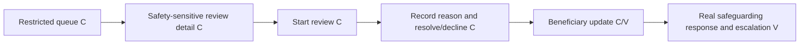

**Works in code:** restricted submitted + under-review queue and protected decision screen; backend scope limits safeguarding-only staff to safety-sensitive requests. **Open:** audited real incident rehearsal, local emergency referral/contact verification, response-time/escalation protocol, privacy and device QA. The app is not an emergency response service by virtue of this screen.

## 7. LSF supervisor (`supervisor`)

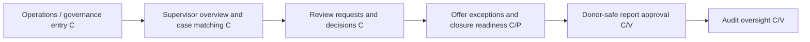

**Works in code:** the mobile supervision overview reads open review requests, pending/overdue assignment offers and open cases. It links to audited review decisions, safeguarding and audit screens. Matching now offers an audited reassignment with a required reason, and a dedicated closure review checks readiness before an audited status change. **Open:** end-to-end reassignment/closure exception rehearsal, service quality evidence beyond case-review requests, separation-of-duties and organisation scope testing, and phone visual acceptance. The reference “Supervisor Review” journey is still partial.

## 8. Content editor (`content_editor`)

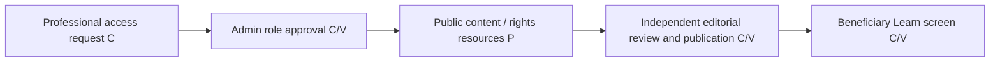

**Works in code:** request/approval path, mobile content-editor authoring and review workspace, bilingual guide submission, independent admin approval with source and review date, audit events, and approved-only beneficiary learning. These functions were deployed to the configured development Convex environment on 29 September 2026. The public Learn route rendered in the browser with zero approved guides; its browser storage crash was corrected. **Open:** verified content creation and independent publication rehearsal with separate accounts, version/supersession policy, native-device and language QA. The role is not the same as Saada source approver; Saada source/prompt approval is administrator-controlled.

## 9. Stakeholder viewer (`stakeholder`)

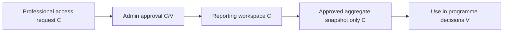

**Works in code:** reporting route restricts this role to approved snapshots. **Open:** real approved snapshot with suppressed small cells, distinct stakeholder account permission rehearsal, report interpretation and device QA. No case-level access should be granted.

## 10. Donor / reporting viewer (`donor`)

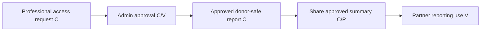

**Works in code:** approved-only reporting display; sharing a safe text summary. **Open:** real disclosure/privacy review, independent snapshot approval, recurring export/delivery, donor-account QA. A text-share action is not a complete donor reporting programme.

## 11. Administrator (`admin`)

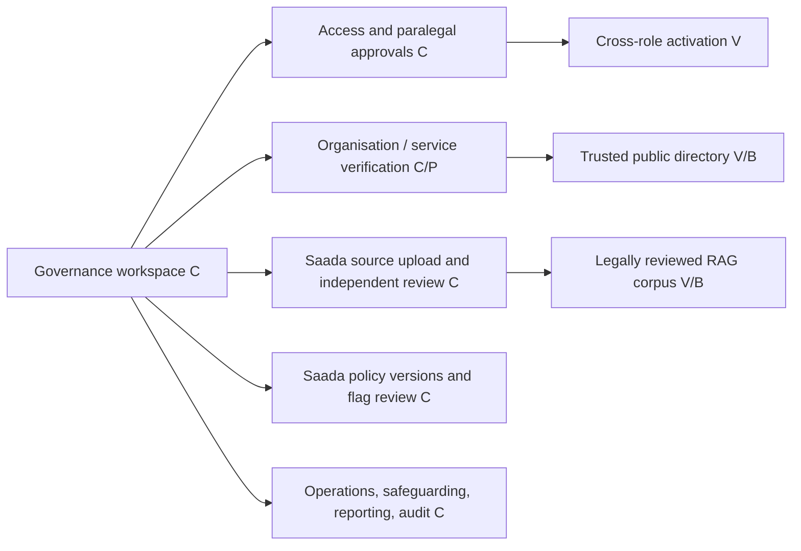

**Works in code:** access and paralegal review details, service directory controls, Saada library/upload, source and prompt version review, flagged-response disposition, reporting and audit routes. **Open:** two-admin separation rehearsal, verified Tanzanian source/provider data and update ownership, permissions/retention review, policy/legal review, full operational device run. Screens alone do not make Saada reliable.

## Cross-role handoffs that determine real completion

| Handoff | Code-connected? | Release evidence still needed |
| --- | --- | --- |
| Guest discovery → verified service contact | Yes | LSF-approved current service records, phone/hours and safe-publication check |
| Beneficiary request → LSF triage → case | Yes | Separate accounts, stored data/status/notification verification |
| LSF offer → paralegal acceptance → shared case | Yes | Two-account run, expiry/decline/reassignment and access revocation; reassignment screen now exists |
| Case → referral proposal → beneficiary consent → provider response | Yes | Three-account run, exact sharing list, withdrawal/onward route and privacy review |
| Saada question → approved source → cited answer → human help | Partial | Tanzania legal corpus, source freshness, evals, high-risk testing and human escalation rehearsal |
| Paralegal application → independent approval → live workspace | Yes | Identity/organisation verification, distinct approver and activation run |
| Saada source/prompt proposal → separate admin approval → retrieval/use | Yes | Two-admin rehearsal, legal review of material and post-approval retrieval proof |
| Content editor → independent guide approval → public Learn | Yes | Separate editor/admin accounts, reviewed Tanzanian source, publication and expiry proof |
| Operations data → donor-safe draft → separate approval → viewer | Yes | Small-cell/privacy review, distinct accounts and export QA |

## Immediate completion order

1. Visually exercise all existing routes on an actual phone in Kiswahili and English, including empty, error, restricted, and filled-data states; fix broken layouts/navigation.
2. Load and verify real public service records and approved legal sources with LSF ownership, provenance, contact checks and review dates.
3. Run end-to-end multi-account scenarios for beneficiary, staff, paralegal, provider, supervisor, safeguarding, admin, and donor roles, recording each status transition and notification.
4. Close remaining specific UI/workflow gaps: organisation-scoped provider management, Saada evaluation/human escalation, map/directions experience where verified coordinates exist, guide version/supersession and reporting delivery.
5. Perform Tanzania legal/safeguarding, privacy, accessibility, offline, security and release checks before claiming any journey fully complete.

**Current status:** the launch app has many connected screens and backend contracts; no user type has a fully evidenced, release-complete journey yet.
